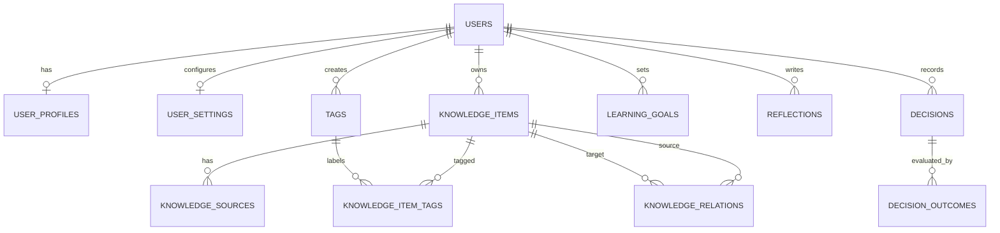

# Entity Relationships

`knowledge_relations` is a directed edge table. Both endpoints must belong to the same user; the database foreign keys enforce endpoint existence, while application-level validation in a later phase must enforce same-owner relationships.
